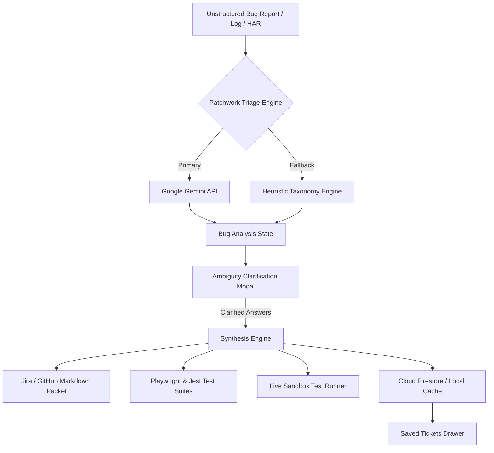

<div align="center">

# 🧩 Patchwork

### *AI-Powered Incident Triage, Ambiguity Resolution & Automated Test Generation*

Transform vague bug reports into verified reproduction steps, isolated root causes, actionable Jira tickets, and executable Playwright & Jest test suites in seconds.

---

[-black?style=for-the-badge&logo=next.js)](https://nextjs.org/)
[](https://react.dev/)
[](https://www.typescriptlang.org/)
[-38B2AC?style=for-the-badge&logo=tailwind-css&logoColor=white)](https://tailwindcss.com/)
[](https://ai.google.dev/)
[](https://firebase.google.com/)
[](https://playwright.dev/)

[Features](#-key-features) • [Architecture](#-system-architecture) • [Live Demo](#-quick-start) • [Triage Engine](#-triage-engine--bug-taxonomy) • [Environment Setup](#-environment-variables)

</div>

---

## ⚡ The Problem: The Cost of Ambiguous Bugs

Engineering and QA teams spend up to **35% of each development sprint** deciphering vague bug reports:

> *"The app froze when I went back after paying."*  
> *"It logged me out for no reason."*  
> *"Payment failed on mobile."*

Developers waste hours guessing device context, trying to reproduce edge cases, and going back-and-forth on Slack. **Patchwork eliminates this friction.**

---

## 🚀 Key Features

### 🧠 Real AI Incident Triage (Google Gemini 3.5 Flash-Lite)
- Ingests unstructured bug descriptions, customer escalations, HAR traces, or stack traces.
- Employs **Principal SRE reasoning** to isolate failure modes, infer client environments, classify severity, and synthesize deterministic reproduction plans in **< 3 seconds**.

### 🔬 Deep Heuristic Bug Taxonomy Engine (Zero-Downtime Fallback)
If AI free-tier quotas are exhausted or offline, Patchwork activates a deterministic, high-fidelity heuristic engine covering:
- **3D Secure / Payment Gateway Drops**: Popstate deadlocks, third-party iframe unmounts, webhook race conditions.
- **Auth Token Races**: Refresh token rotation collisions across multiple concurrent tabs with zero-grace windows.
- **CORS / Preflight Failures**: Missing `Access-Control-Allow-Origin`, 403 on preflight `OPTIONS` requests.
- **Memory Leaks & Infinite Loops**: React `useEffect` dependency cycles, listener leaks, and heap saturation.
- **Reverse Proxy Timeouts**: 502/504 Bad Gateway / Gateway Timeout recovery and circuit breaker handling.
- **React SSR Hydration Mismatches**: Server vs client virtual DOM drift, timezone/locale mismatches.

### ❓ Interactive Ambiguity Clarification
- Pinpoints the **missing technical variables** before writing code.
- Generates categorized questions (`payment_gateway`, `device_os`, `recovery_action`, `auth_state`, `network_transport`) with contextual placeholders to guide non-technical reporters.

### 🧪 Live Interactive Sandbox Test Runner
- Features an integrated terminal emulator simulating real Playwright E2E and Jest Unit test runs.
- Compare **Buggy Baseline** (demonstrating reproduction and failure assertion) vs **Patched Branch** (demonstrating test pass and regression prevention).

### 📋 1-Click Jira & GitHub Issue Export
- Generates beautifully structured GitHub/Jira Markdown including Environment Telemetry, Established Facts, Reproduction Steps, Expected vs Actual Behavior, and Proposed Fixes.

### 🔐 Firebase Authentication & Cloud Firestore Persistence
- **Sign In with Google** and **Email/Password** authentication.
- **Saved Tickets Drawer**: Save bug triage packets, search by keyword or severity, copy Jira Markdown, and restore any ticket back into your active workbench.
- **Resilient Offline Cache**: Automatic local storage fallback if Cloud Firestore is unreachable.

### 🛡️ Enterprise Security Hardening
- **Sliding-Window IP Rate Limiting**: Protects backend APIs against abuse and denial-of-wallet.
- **Anti-Prompt Injection Shield**: Sanitizes raw input and neutralizes jailbreak attempts.
- **Strict Content Security**: Avatar hotlink referrer protection, zero inline credentials.

---

## 🏗️ System Architecture



---

## 📂 Project Directory Structure

```text
patchwork/
├── src/
│   ├── app/
│   │   ├── api/
│   │   │   ├── analyze/        # AI triage & heuristic bug analysis route
│   │   │   └── run-test/       # Sandbox test runner streaming logs endpoint
│   │   ├── layout.tsx          # Root layout wrapped with AuthProvider
│   │   ├── page.tsx            # Main Workbench: Intake -> Clarification -> Report
│   │   └── globals.css         # Tailwind dark theme base styling
│   ├── components/
│   │   ├── auth/               # Firebase Auth Modal (Google & Email/Password)
│   │   ├── layout/             # Top Navbar, workflow steps & profile controls
│   │   ├── report/             # Developer Report View, Live Test Runner & Code Exporters
│   │   ├── tickets/            # Saved Tickets Drawer (Search, Load, Delete, Copy)
│   │   ├── ui/                 # Reusable UI primitives (Button, Card, Badge, Modal)
│   │   ├── ClarificationForm.tsx
│   │   └── IntakeForm.tsx
│   ├── context/
│   │   └── AuthContext.tsx     # Firebase Auth state & methods provider
│   ├── lib/
│   │   ├── firebase.ts         # Firebase App, Auth & Firestore singleton
│   │   ├── firestore.ts        # Cloud persistence service with local fallback
│   │   ├── rate-limit.ts       # Sliding-window IP rate limiter
│   │   ├── security.ts         # Input sanitizer & prompt injection filter
│   │   └── utils.ts            # Classnames (clsx/twMerge) utility
│   └── types/
│       ├── analysis.ts         # Developer report & root cause types
│       └── bug.ts              # Analysis, raw report & question types
├── .env.example                # Sample environment variables template
├── next.config.ts              # Next.js 16 configuration
├── tailwind.config.ts          # Tailwind CSS styling configuration
└── package.json
```

---

## 🛠️ Quick Start

### 1. Prerequisites
- [Node.js](https://nodejs.org/) v20.x or higher
- [npm](https://www.npmjs.com/) or `pnpm`
- A [Google AI Studio](https://aistudio.google.com/) Gemini API Key
- A [Firebase Console](https://console.firebase.google.com/) project with **Authentication** and **Cloud Firestore** enabled

### 2. Clone the Repository
```bash
git clone https://github.com/sahilchavan2008-maker/patchwork.git
cd patchwork
```

### 3. Install Dependencies
```bash
npm install
```

### 4. Configure Environment Variables
Create a `.env.local` file in the project root based on `.env.example`:

```bash
cp .env.example .env.local
```

Fill in your actual API credentials:

```ini
# Google Gemini API Key (for AI Bug Triage)
GEMINI_API_KEY=AIzaSy...

# Firebase Web App Credentials
NEXT_PUBLIC_FIREBASE_API_KEY=AIzaSy...
NEXT_PUBLIC_FIREBASE_AUTH_DOMAIN=your-project.firebaseapp.com
NEXT_PUBLIC_FIREBASE_PROJECT_ID=your-project-id
NEXT_PUBLIC_FIREBASE_STORAGE_BUCKET=your-project.firebasestorage.app
NEXT_PUBLIC_FIREBASE_MESSAGING_SENDER_ID=1234567890
NEXT_PUBLIC_FIREBASE_APP_ID=1:1234567890:web:abcdef123456
NEXT_PUBLIC_FIREBASE_MEASUREMENT_ID=G-XXXXXXXXXX
```

### 5. Start the Development Server
```bash
npm run dev
```

Open [http://localhost:3000](http://localhost:3000) in your browser.

---

## 🧪 Testing the Application

### 1. Run the Vague Bug Demo
Click **Run Vague Bug Demo** on the top navigation bar to test an incident without manual typing:
- Scenario: *"When I go back after payment it gets stuck on spinner"*
- The triage engine immediately isolates the `popstate` history deadlock, suggests 3 clarification questions, and provides an end-to-end Playwright script.

### 2. Run Interactive Test Sandbox
In the **Developer Report View**, select the **Live Test Runner** tab:
1. Click **Run Buggy Reproduction**: Watch the simulated browser launch, navigate, and fail assertion on the infinite spinner with stack trace.
2. Click **Run Patched Verification**: Watch the idempotent state guard engage and pass all assertions in `1.2s`.

### 3. Build for Production
To ensure zero TypeScript or compilation errors:
```bash
npm run build
```

---

## 🔑 Environment Variables Reference

| Variable | Description | Required | Client-Side Inlined |
| :--- | :--- | :---: | :---: |
| `GEMINI_API_KEY` | Google Gemini API key used in `/api/analyze` | **Yes** | ❌ (Server-side only) |
| `NEXT_PUBLIC_FIREBASE_API_KEY` | Firebase Web API Key | **Yes** | ✅ |
| `NEXT_PUBLIC_FIREBASE_AUTH_DOMAIN` | Firebase Authentication Domain | **Yes** | ✅ |
| `NEXT_PUBLIC_FIREBASE_PROJECT_ID` | Firebase Project ID | **Yes** | ✅ |
| `NEXT_PUBLIC_FIREBASE_STORAGE_BUCKET` | Firebase Cloud Storage Bucket | No | ✅ |
| `NEXT_PUBLIC_FIREBASE_MESSAGING_SENDER_ID` | Firebase Messaging Sender ID | No | ✅ |
| `NEXT_PUBLIC_FIREBASE_APP_ID` | Firebase Web App ID | **Yes** | ✅ |
| `NEXT_PUBLIC_FIREBASE_MEASUREMENT_ID` | Google Analytics Measurement ID | No | ✅ |

---

## 🔒 Security Best Practices

- **Zero Secret Leakage**: All `.env*` files are strictly excluded from version control via `.gitignore`.
- **Referrer-Policy Protection**: External avatar images enforce `referrerPolicy="no-referrer"` to prevent cross-origin 403 blocks.
- **Client Sanitization**: All incoming bug payloads pass through `sanitizeBugInput()` to strip malicious injection vectors before hitting the LLM.

---

## 📄 License

This project is licensed under the [MIT License](LICENSE).

---

<div align="center">
Built with 💙 by Sahil Chavan & the Patchwork Team.
</div>
